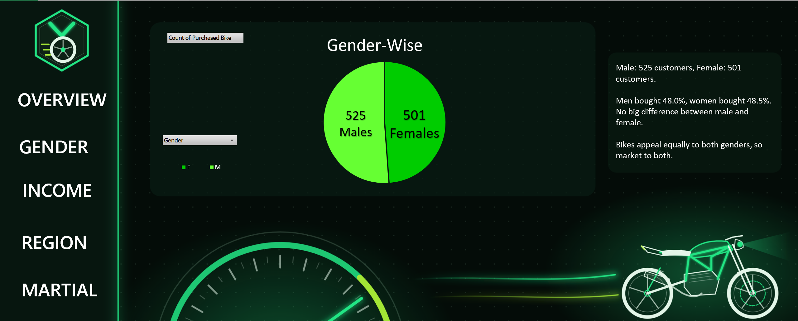
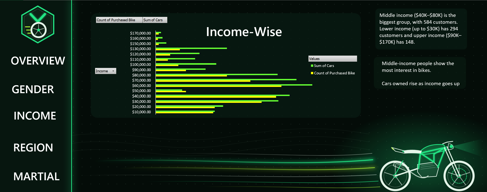
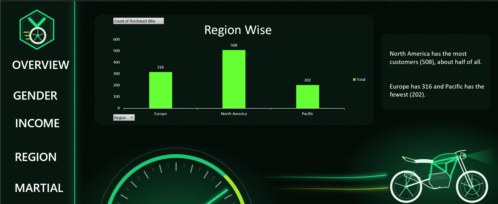
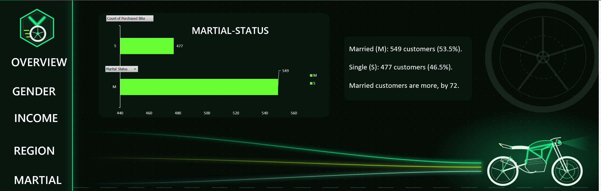
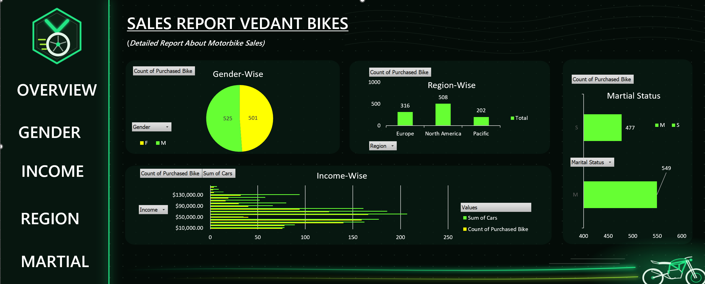

# 🏍️ Vedant Bikes — Sales & Customer Performance Dashboard

An interactive Excel dashboard analyzing motorbike purchase behaviour across 1,026 customers. Built with **PivotTables, PivotCharts, and Slicers**, the dashboard uses a dark neon, brand-styled UI with clickable navigation buttons (**Overview, Gender, Income, Region, Marital**) linked to a shared PivotCache for seamless filtering across sheets.

---

## 🖼️ Preview

| Gender | Income |
|---|---|
|  |  |

| Region | Marital |
|---|---|
|  |  |

### Overview — Full Dashboard



---

## 🧩 Pages / Sheets

| Page | Contents |
|---|---|
| **Overview** | Landing page with branded header, KPI framing and navigation to all analysis views |
| **Gender** | Pie + column charts comparing male vs. female customers, with written insight callouts |
| **Income** | Column chart of customers and cars owned per income band, with an **Income slicer** |
| **Region** | Column chart ranking Europe / North America / Pacific by customer volume |
| **Marital** | Bar chart comparing married vs. single customers |
| **dataset_bikes** | Cleaned source data — 1,026 rows × 13 columns, zero nulls |
| **pivot_chart_1–4** | Backing PivotTables driving every visual on the dashboard |

---

## 🔍 Key Insights

- **Overall conversion:** 495 of 1,026 customers (**48.2%**) purchased a bike — a near-even split, meaning the real story lies in the differences *between* segments, not the headline number.
- **Gender is not a differentiator:** Male 525 vs. Female 501 customers, converting at **48.0%** and **48.5%** respectively — statistically identical. Campaign budget should not be skewed by gender.
- **Middle income is the core market:** The **$40K–$80K** band holds **584 customers** (57% of all), versus 294 in the lower band (≤$30K) and just 148 in the upper band ($90K–$170K). Car ownership rises steadily with income — higher earners buy cars instead of bikes.
- **Volume vs. conversion gap by region:** North America supplies the most customers (**508**, half the base) but converts worst at **43.3%**; the Pacific has the fewest customers (**202**) yet converts best at **58.9%** — a clear case for reallocating spend.
- **Single customers convert better:** Married customers are more numerous (549 vs. 477), but singles convert at **54.3%** against **43.0%** for married customers — an 11-point gap hidden behind the raw counts.
- **Commute distance is the strongest predictor:** Customers commuting 2–5 miles convert at **58.6%** and 0–1 miles at **54.8%**, while the 10+ mile group collapses to **29.2%** — roughly **half** the purchase likelihood.

---

## 🛠️ Tools & Techniques Used

- PivotTables & PivotCharts (Pie, Column, Bar)
- Report Connections / shared Slicers across sheets
- Custom dark neon UI theme with shape-based navigation menu
- Dynamic data labels and insight callouts
- Data cleaning and validation (zero nulls, zero duplicates)

---

## 📁 Repository Structure

```
├── Bike_Sales_Dashboard.xlsx
├── bikes_overview.png
├── bikes_gender.png
├── bikes_income.png
├── bikes_region.png
├── bikes_marital.png
└── README.md
```

---

## 💡 Skills Demonstrated

- Data modeling with PivotTables
- Interactive dashboard design (slicers, navigation, theming)
- Segment analysis and conversion-rate interpretation
- Business insight generation from visualized data
- Excel data visualization best practices (chart selection, labeling, layout)

---

## 👤 Author

**Tanvi Mehra**

🔗 **LinkedIn:** [linkedin.com/in/tanvi-mehra-9a148a26b](https://www.linkedin.com/in/tanvi-mehra-9a148a26b/)
📧 **Email:** tanvimehra.05@gmail.com
📞 **Phone:** +91 9015221547

Feel free to connect if you'd like to discuss the dashboard or collaborate on data analysis projects.
